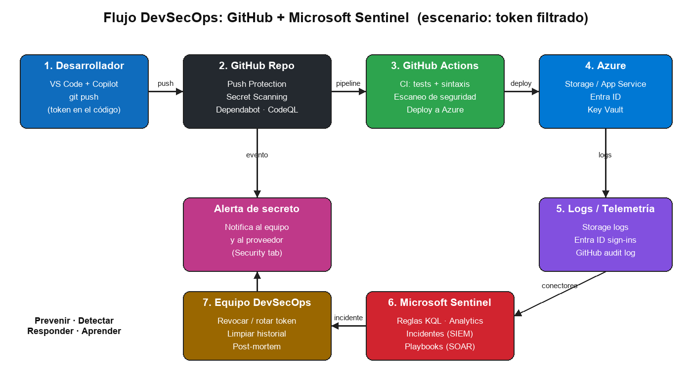

# 🔄 Laboratorio 4 – DevSecOps

**Dificultad:** ⭐⭐ Intermedio · **Duración:** 15 min

## Objetivo
Entender cómo se conectan **GitHub** (código y CI/CD) y **Microsoft Sentinel** (detección y respuesta) en un ciclo DevSecOps.



## Conceptos clave
| Herramienta | Función | Momento |
|---|---|---|
| Copilot | Genera código y ayuda a revisarlo | Plan / Code |
| Secret Scanning + Push Protection | Detecta/bloquea secretos | Code (antes y después del push) |
| Dependabot | Alertas y PRs de dependencias vulnerables | Build |
| CodeQL (Code Scanning) | Análisis estático (SQLi, etc.) | Build / Test |
| GitHub Actions | CI/CD automatizado | Build / Deploy |
| Microsoft Sentinel (SIEM/SOAR) | Correlaciona logs, alerta y automatiza respuesta | Operate / Monitor |

## Actividad
1. Lee [`scenario.md`](scenario.md).
2. En equipo, respondan las 6 preguntas (10 min).
3. Compartan con otro equipo y comparen (5 min).
4. Activen en su fork: *Settings → Code security* → Secret scanning, Push protection y Dependabot alerts (5 min).

## Ejemplo de consulta KQL (Sentinel)
Acceso a Blob Storage con SAS desde IP no habitual:
```kusto
StorageBlobLogs
| where TimeGenerated > ago(1h)
| where AuthenticationType == "SAS"
| where OperationName in ("GetBlob", "ListBlobs")
| summarize Requests = count(), Bytes = sum(ResponseBodySize) by CallerIpAddress, AccountName
| where Requests > 100
```

## ✅ Checklist
- [ ] Respondí las 6 preguntas
- [ ] Activé Secret Scanning y Dependabot en mi fork
- [ ] Puedo explicar la diferencia entre *prevenir*, *detectar* y *responder*
